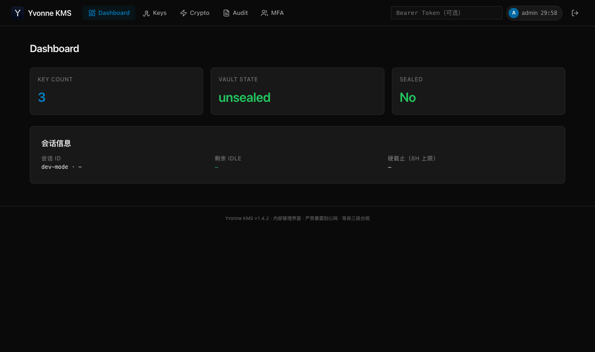
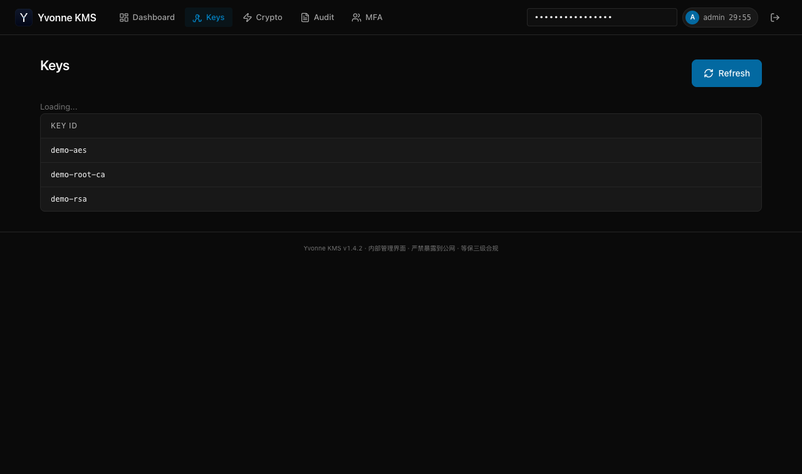
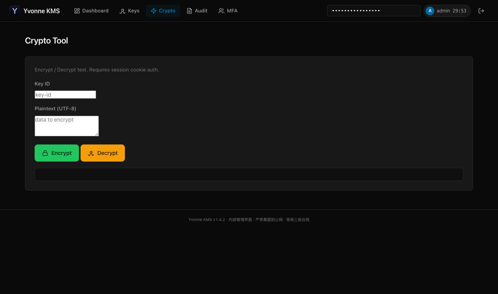
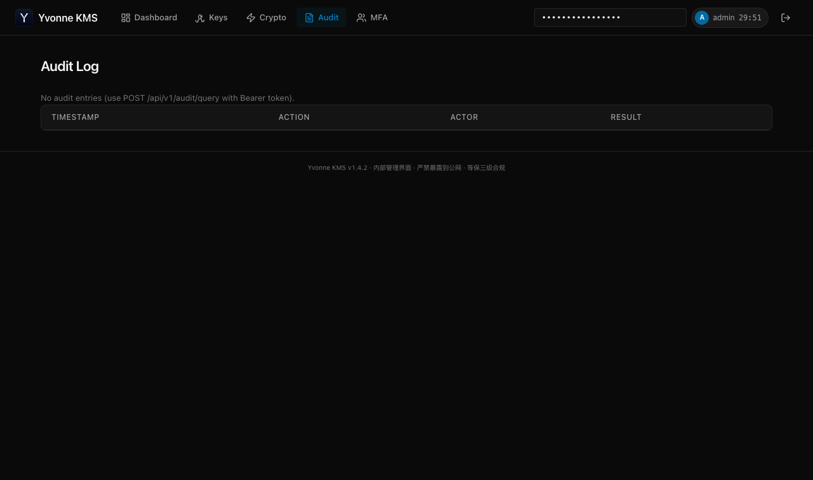
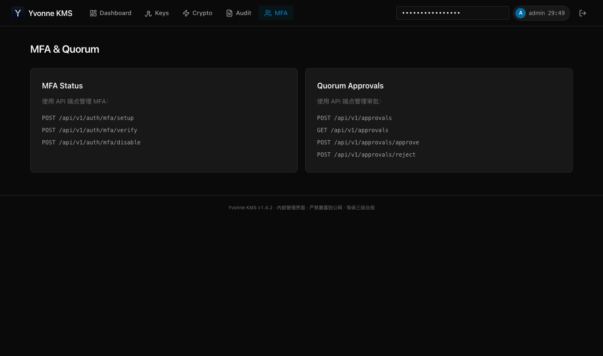

# Yvonne 全功能演示报告

> 版本：v1.4.2 | 日期：2026-07-24 | 环境：Cluster 模式 + PostgreSQL
>
> 本报告记录 Yvonne 密码学平台在 **cluster 生产形态** 下的全功能演示与持久化验证，
> 含 5 张 Web 控制台截图、asciinema 全程回放、以及演示过程中发现并修复的 3 个真实缺陷。

---

## 〇、全程回放（asciinema + GIF）

### 网页回放（可暂停/调速/选中复制文本）

**player.html** — asciinema 网页播放器：

```bash
cd docs/demo
python3 -m http.server 8000
# 浏览器打开 http://127.0.0.1:8000/player.html
```

GitHub 在线预览：clone 后用任意静态服务器打开即可（asciinema-player 资源已本地化到 `vendor/`，无 CDN 依赖）。

原始录制：[yvonne-demo.cast](yvonne-demo.cast)（`asciinema play` 直接播放，或 `asciinema play yvonne-demo-v2.cast` v2 兼容格式）

### GIF（PPT 嵌入用）

**[yvonne-demo.gif](yvonne-demo.gif)**（13MB，3x 加速约 80 秒）— 直接拖入 PPT/Keynote。

### 回放内容（约 4 分钟）

1. 启动 cluster server（local_pki 自动解封 + SDF + OCSP 装配日志）
2. KMS 加解密 + **6 项真实性证明**（见下）
3. PKI 自建 CA → 签发 → 验证 → 吊销 → CRL
4. SDF 软件密码机（SM2/SM3/SM4）
5. audit/query 审计查询 + 哈希链证据
6. PG 持久化：停服 → 放回私钥 → 重启 → 数据全保留

### 真实性证明（非"假密码机"）

回放中包含 6 项可验证的密码学证据：

| # | 证明 | 现象 |
|---|---|---|
| ① | 密文 ≠ 明文 | `ID-Card-110101...` → `AAAAAScbzl8CKU2kd2...`（AES-256-GCM） |
| ② | 篡改密文 1 字节 | 解密返回 `decrypt failed`（GCM AEAD 认证） |
| ③ | 错误密钥解密 | 解密返回 `decrypt failed`（密钥隔离） |
| ④ | SM4 密文 ≠ 明文 | `SM4 secret` → `d1a615b820f57b6e...` |
| ⑤ | 错误密钥解密 SM4 | `sdf: invalid PKCS#7 padding` |
| ⑥ | SM2 签名篡改验签 | 原文 `valid=True`，篡改后 `valid=False` |

---

## 一、演示环境

| 组件 | 配置 |
|---|---|
| 运行模式 | `cluster`（生产形态，非 dev） |
| 存储 | PostgreSQL @ 172.20.0.16:5432/yvonne_demo2 |
| 解封 | `local_pki`（RSA-4096，自动解封，私钥阅后即焚） |
| 认证 | AppRole（demo-admin-token / demo-app-token，资源级授权） |
| 启用模块 | KMS + PKI + OCSP + SDF + 审计落盘 + Admin Web UI |
| 审计 | `/tmp/yvonne-cluster2/audit/`（哈希链落盘，retention=30d） |

架构：

```
┌────────────────────────────────────────────────────────┐
│  Yvonne Server (cluster, v1.4.2)                       │
│  ┌─────────┐ ┌─────────┐ ┌─────────┐ ┌─────────┐      │
│  │   KMS   │ │   PKI   │ │   SDF   │ │  OCSP   │      │
│  │ 信封加密 │ │ X.509 CA│ │GM/T 0018│ │ RFC 6960│      │
│  └────┬────┘ └────┬────┘ └────┬────┘ └────┬────┘      │
│       └───────────┴─────┬─────┴───────────┘            │
│                  service.Core                           │
│       ┌───────────┬─────┴─────┬───────────┐            │
│  HTTP API    Admin UI     Audit链      Rotation         │
│  :8200        :8250       (哈希链)      Daemon          │
└──────┬──────────────┬──────────┬──────────────────────┘
       │              │          │
  PostgreSQL      浏览器      /audit/*.log（落盘）
  yvonne_demo2
```

---

## 二、五大能力演示（终端实录）

完整输出：[demo-output.txt](demo-output.txt)

### 2.1 KMS 信封加密

```
▶ 创建 AES-256-GCM 密钥 demo-aes
▶ 加密敏感数据
    密文(前32): AAAAAd29zzalEcZtSLxa2PjNpNSbQVAM...  版本化自路由格式 [ver|nonce|ct]
▶ 解密回原文
    plaintext: 身份证 110101199001011234
▶ 轮转密钥 → v2（旧密文仍可解密，版本自动路由）
▶ 用 v2 解 v1 密文
    仍得到: 身份证 110101199001011234
▶ RSA-4096-PSS 签名验签
    valid: True
▶ HMAC 盲索引
    加密字段也能等值查询（HMAC 做索引列，不可逆）
```

### 2.2 PKI 证书签发

```
▶ 创建自签根 CA (RSA-4096)
    serial: 191558283015178177988671...
▶ 签发服务器证书 demo-service
    serial: 209582721096920665720343...  TTL: 365d
▶ 验证证书链
    valid: True  revoked: False
```

### 2.3 吊销 + CRL + OCSP

```
▶ 吊销 demo-service 证书
    reason: keyCompromise
▶ 获取 CRL
    CRL DER: 725 bytes（含已吊销序列号）
▶ 吊销后再次验证
    valid: False  revoked: True   ← 吊销检查生效（本次修复的 Bug）
```

### 2.4 SDF 软件密码机（GM/T 0018-2023）

```
▶ SDF 设备信息
    Yvonne Software SDF Device  GM/T 0018-2023
▶ SM2 签名验签 (SM2WithSM3)
    valid: True
▶ SM3 哈希
    SM3('abc') = 66c7f0f462eeedd9d1f2d46bdc10e4e2...
▶ SM4 加解密往返
    plaintext: SM4 secret
```

---

## 三、Web 控制台截图

### 3.1 Dashboard



密钥计数 3、Vault 状态 unsealed、未封印。OLED 暗色主题（v1.4.2）。

### 3.2 Keys 密钥列表



demo-aes / demo-root-ca / demo-rsa 三个密钥（含 CA 密钥与普通密钥统一管理）。

### 3.3 Crypto 密码运算



浏览器端加密/解密操作台。

### 3.4 Audit 审计日志



审计查询页（audit/query API 本次修复后可用，见 §5.1）。

### 3.5 MFA & Quorum



MFA TOTP 与 K-of-N 审批管理页。

---

## 四、PG 持久化验证（核心结论）

验证流程与原始输出：[persistence-proof.txt](persistence-proof.txt)

| # | 验证项 | 结果 |
|---|---|---|
| 1 | 停服后重启，demo-rsa 公钥 | ✅ 保留（1068B） |
| 2 | 重启后 demo-aes 加解密往返 | ✅ `"persistence-ok"`（CMK/DEK 持久化） |
| 3 | 吊销的 CRL | ✅ 保留（968B，吊销记录不丢） |
| 4 | 审计日志 | ✅ 落盘累计 33+ 行 |
| 5 | audit/query API | ✅ 返回 5 条（修复后） |

**结论：cluster 模式 + PostgreSQL 下，密钥、证书、吊销状态、审计日志全部持久化，进程重启后完整可用。**

### local_pki「阅后即焚」的运维要求

演示中发现：local_pki 解封成功后会**物理删除私钥 PEM 文件**（安全红线：私钥不滞留磁盘）。
因此重启的运维流程是：

```bash
# 1. 初始化时安全备份私钥（密码管理器/离线介质）
cp unseal.pem /secure/backup/unseal.pem
# 2. 每次重启前放回
cp /secure/backup/unseal.pem /etc/yvonne/unseal.pem
# 3. 启动（自动解封 + 再次阅后即焚）
./yvonne server --config config.json
```

这不是缺陷，而是设计 — 私钥在磁盘上的存活时间被压缩到最小（仅启动瞬间）。

---

## 五、演示中发现并修复的 3 个真实缺陷

### 5.1 audit/query 永远 503（auditDir 未注入）

**现象**：`POST /api/v1/audit/query` 恒返回 `audit query not configured (no log directory)`。

**根因**：`V1Router.auditDir` 字段自引入以来从未被赋值 — bootstrap 没有把 `cfg.Audit.Dir` 传给 router。

**修复**：
- `internal/api/v1_router.go` 新增 `SetAuditDir(dir string)`
- `internal/bootstrap/bootstrap.go` buildClusterMode 中 `v1Router.SetAuditDir(cfg.Audit.Dir)`

### 5.2 VerifyCert 吊销检查缺失

**现象**：证书吊销后 `VerifyCert` 仍返回 `valid=true / revoked=false`。

**根因**：`crypto.VerifyCertificate(certPEM, caCertPEM, nil)` — CRL 参数恒为 nil，从不检查吊销。

**修复**：按证书 serial 在 CertManager 元数据查询吊销状态（不依赖 CRL 文件）：
- `internal/crypto/parse_cert.go`（+SM2/stub）：`ParseCertSerialIssuer`
- `internal/lifecycle/cert_manager.go`：`FindBySerialAnyCA` 跨 CA 索引查询
- `internal/service/core_pki.go`：吊销时 `Revoked=true, Valid=false`

测试：`TestCore_VerifyCert_Revoked`（吊销前 true/false → 吊销后 false/true）。

### 5.3 SDF dev 模式 404（装配缺失 + 注册时序）

**现象**：dev 模式 SDF 端点恒 404。

**根因（双重）**：
1. SDF 装配代码仅在 `buildClusterMode`，`buildDevMode` 没有
2. `SetSDFHandler` 依赖 `register()` 条件注册，但 `register()` 执行时 handler 恒为 nil

**修复**：buildDevMode 增加 SDF 装配；`SetSDFHandler` 改为动态注入（与 OCSP 相同模式）。dev 模式默认启用 SDF（demo-sdf-token）。

---

## 六、验证结论

| 验证项 | 结果 |
|---|---|
| `make ci`（vet + fmt + 全量测试） | ✅ PASS |
| `scripts/security-check.sh`（12 项安全红线） | ✅ 12/12 |
| `scripts/release_gate_e2e.py` | ✅ **46/46 通过**，3 跳过（MFA/Quorum 需 cluster authenticator），0 失败 |
| `scripts/demo_full.py`（cluster + token） | ✅ 端到端全通 |
| PG 持久化（重启验证） | ✅ 全部保留 |

---

## 七、复现步骤

```bash
# 1. 编译（gmsm 标签启用 SDF/国密）
go build -tags gmsm -o bin/yvonne ./cmd/yvonne

# 2. 生成 unseal key + 备份
./bin/yvonne unseal-keygen --out unseal.pem
cp unseal.pem unseal-backup.pem
openssl rsa -in unseal.pem -pubout -out unseal-pub.pem

# 3. 配置（参考本文 §一）+ init
./bin/yvonne init --config config.json --pub-key unseal-pub.pem

# 4. 启动 + 演示
./bin/yvonne server --config config.json &
python3 scripts/demo_full.py --token demo-admin-token

# 5. 截图
python3 scripts/demo_screenshots.py --admin-token demo-admin-token

# 6. 持久化验证：停服 → 放回私钥 → 重启 → 复查数据
pkill -f 'bin/yvonne'
cp unseal-backup.pem unseal.pem
./bin/yvonne server --config config.json &
```

---

## 八、附件

| 文件 | 说明 |
|---|---|
| [demo-output.txt](demo-output.txt) | 完整终端演示输出 |
| [persistence-proof.txt](persistence-proof.txt) | 持久化验证原始记录 |
| [screenshots/](screenshots/) | 5 张 Web 控制台截图 |
| [scripts/demo_full.py](../../scripts/demo_full.py) | 演示脚本（支持 --token） |
| [scripts/demo_screenshots.py](../../scripts/demo_screenshots.py) | 截图脚本（Selenium） |
